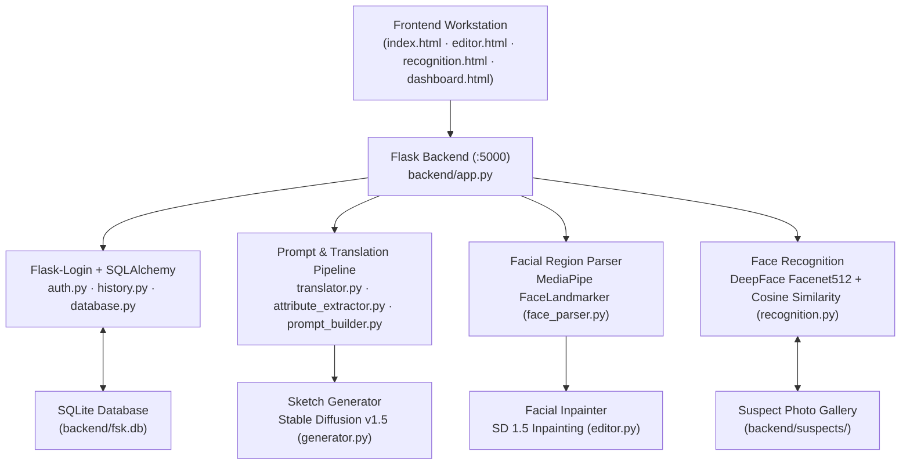

# 📊 AI-Powered Forensic Sketch Generation & Recognition — Detailed Project Report

**Project Name:** Forensic Sketch Generation & Recognition System (`fsk`)  
**Tech Stack:** Python, Flask 3.1, SQLAlchemy, Flask-Login, PyTorch, Diffusers (Stable Diffusion 1.5), MediaPipe FaceLandmarker, DeepFace (`Facenet512`), Deep Translator, Vanilla HTML/CSS/JS  
**Target Hardware:** Consumer GPU (e.g., NVIDIA RTX 3050 4GB VRAM) with automatic CPU and Mock-Mode fallbacks  

---

## 1. Executive Summary

This system provides law enforcement analysts and forensic researchers with an interactive browser-based workstation to:
1. **Generate** composite forensic pencil sketches from natural-language witness descriptions (supporting multilingual inputs such as Marathi via automatic translation) or structured attributes.
2. **Refine** specific facial regions (`eyes`, `nose`, `mouth`, `jaw`, `forehead`, `hair`) using semantic landmark masking and **Stable Diffusion Inpainting**.
3. **Match** generated sketches against either a specific photo (`1:1` verification) or an indexed suspect photo repository (`1:N` database search in `backend/suspects/`).
4. **Track** every generation, edit, and recognition run per authenticated user in SQLite with thumbnails and metadata.

---

## 2. System Architecture



---

## 3. Core Pipelines & Technical Details

### 3.1 Multilingual Prompting & Sketch Generation (`generator.py`, `utils/`)
- **Multilingual Input (`translator.py`):** Non-English or Unicode inputs (e.g., Marathi characters detected via `ord(c) > 127`) are automatically translated to English via `deep-translator` before prompt construction.
- **Prompt Engineering (`prompt_builder.py`):** Converts witness descriptions (`build_natural_prompt`) or structured facial attributes (`build_forensic_prompt`) into forensic sketch prompts paired with `get_negative_prompt()`.
- **Model Loading (`_load_pipeline`):** Checks for a custom local checkpoint (`CUSTOM_MODEL_PATH = backend/my_trained_model.safetensors`) via `StableDiffusionPipeline.from_single_file`; if absent, loads `runwayml/stable-diffusion-v1-5` with `EulerDiscreteScheduler`.
- **4GB VRAM Optimizations:** Enables `torch.float16` on CUDA, `enable_attention_slicing()`, `enable_vae_slicing()`, `enable_vae_tiling()`, `enable_model_cpu_offload()`, and optional `xformers` memory-efficient attention.

### 3.2 Semantic Facial Region Parsing & Inpainting (`face_parser.py`, `editor.py`)
- **Landmark Masking (`get_region_mask`):** Uses **MediaPipe FaceLandmarker** (`backend/models/face_landmarker.task`) to map 468+ facial landmarks into polygons for `left_eye`, `right_eye`, `eyes`, `nose`, `mouth`, `jaw`, `forehead`, and `hair`.
  - Standard regions apply morphological dilation (`padding=15` via `ImageFilter.MaxFilter(3)`) for seamless inpainting boundaries.
  - The `hair` region computes a bounding box extending upward/sideways from the head silhouette and subtracts an 8px-dilated face silhouette mask to protect core facial identity.
- **Multi-Region Detection:** `/api/edit` merges the user's selected UI region with `auto_detect_regions(modification)` extracted from the edit prompt.
- **Inpainting (`edit_face`):** Calls `torch.cuda.empty_cache()` prior to loading `runwayml/stable-diffusion-inpainting` (`guidance_scale=10.0`, `strength=0.95`) and saves outputs to `backend/outputs/edit_<timestamp>.png`.

### 3.3 Face Recognition & Suspect Search (`recognition.py`)
- **Primary Embedding Extractor (`get_embedding`):** Uses **DeepFace** (`model_name="Facenet512"`, `detector_backend="opencv"`, `align=True`, `enforce_detection=False`) to generate facial feature vectors.
- **Structural Fallback:** If DeepFace fails or `MOCK_MODE=True`, converts the image to a normalized `48×48` grayscale unit vector so comparison endpoints stay operational.
- **Matching Logic (`compare`, `search_in_database`):** Computes clamped cosine similarity in `[0.0, 1.0]` against `RECOGNITION_THRESHOLD = 0.65`:
  - `1:1` (`compare`): `>= 0.65` → High-Confidence Match; `>= 0.50` → Possible Lookalike; `< 0.50` → No Match.
  - `1:N` (`search_in_database`): Scans `.jpg`, `.jpeg`, `.png`, `.webp` files in `backend/suspects/` (`>= 0.65` → Match found; `>= 0.40` → Possible lead; `< 0.40` → No similar suspects found).

---

## 4. Database Schema (`models/database.py`)

Initialized automatically by `init_db(app)` into `backend/fsk.db`:

### `users` Table
| Column | Type | Constraints | Description |
| :--- | :--- | :--- | :--- |
| `id` | `Integer` | Primary Key | User ID |
| `username` | `String(80)` | Unique, Indexed, Not Null | Login username |
| `email` | `String(120)` | Unique, Indexed, Not Null | User email |
| `password_hash` | `String(256)` | Not Null | Werkzeug password hash |
| `created_at` | `DateTime` | Default UTC | Account creation timestamp |

### `history` Table
| Column | Type | Constraints | Description |
| :--- | :--- | :--- | :--- |
| `id` | `Integer` | Primary Key | History entry ID |
| `user_id` | `Integer` | Foreign Key (`users.id`), Indexed | Owner user ID |
| `action_type` | `String(20)` | Indexed, Not Null | `generate`, `edit`, or `recognize` |
| `prompt` | `Text` | Default `""` | Prompt or recognition status message |
| `image_filename` | `String(255)` | Default `""` | Saved PNG filename in `backend/outputs/` |
| `thumbnail` | `Text` | Default `""` | Base64 PNG thumbnail (`128×128`) |
| `metadata_json` | `Text` | Default `"{}"` | JSON metadata (`region`, `similarity`, `match`) |
| `created_at` | `DateTime` | Default UTC | Action timestamp |

---

## 5. API Endpoints Reference

### Authentication (`/api/auth`)
| Method | Endpoint | Auth | Description |
| :--- | :--- | :--- | :--- |
| `POST` | `/api/auth/signup` | Public | Validates username (`>=3`, `[a-zA-Z0-9_]`), email, password (`>=6`), creates user |
| `POST` | `/api/auth/login` | Public | Authenticates and sets persistent Flask-Login session (`remember=True`) |
| `POST` | `/api/auth/logout` | Required | Clears user session |
| `GET` | `/api/auth/me` | Optional | Returns current user JSON or `401` |

### Core AI & Utility Endpoints
| Method | Endpoint | Auth | Description |
| :--- | :--- | :--- | :--- |
| `GET` | `/api/health` | Public | Returns `{status, mock_mode, gpu}` |
| `POST` | `/api/generate` | Required | Text/attributes/seed/steps/language → base64 sketch PNG + history entry |
| `POST` | `/api/edit` | Required | Base64 image + region(s) + modification → edited image + binary mask |
| `POST` | `/api/recognize` | Required | 1:1 comparison between `image1` (sketch) and `image2` (photo) |
| `POST` | `/api/search` | Required | 1:N search of uploaded sketch against `backend/suspects/` |
| `GET` | `/api/regions` | Public | Lists supported MediaPipe facial regions |
| `GET` | `/api/outputs/<filename>` | Public | Serves generated/edited images from `backend/outputs/` |
| `GET` | `/api/suspects/<filename>` | Public | Serves suspect photos from `backend/suspects/` |

### History (`/api/history`)
| Method | Endpoint | Auth | Description |
| :--- | :--- | :--- | :--- |
| `GET` | `/api/history` | Required | Paginated history (`type`, `page`, `limit <= 50`) |
| `GET` | `/api/history/<entry_id>` | Required | Fetch single owned history entry |
| `DELETE` | `/api/history/<entry_id>` | Required | Delete single owned history entry |

---

## 6. Security & Repository Hygiene Applied

1. **Removed Hardcoded `SECRET_KEY`:** Replaced the static placeholder key in `backend/config.py` with `os.environ.get("SECRET_KEY") or secrets.token_hex(16)` and added `.env.example`.
2. **Excluded Databases, Generated Outputs & Logs (`.gitignore`):** Excluded `*.db` (`backend/fsk.db`), `backend/outputs/` (43.6 MB of local run images), `backend/uploads/`, `backend/server.log`, `cuda_output.txt`, `tmp_check_cuda.py`, `backend/my_test_output.png`, `__pycache__/`, and `*.safetensors` while preserving `backend/suspects/` demo photos and `backend/models/face_landmarker.task`.

---

## 7. Run Commands

```powershell
cd backend
python -m venv venv
.\venv\Scripts\Activate.ps1
pip install -r requirements.txt
$env:SECRET_KEY="your_secret_key_here"
python app.py
```

Open **`http://localhost:5000`** in your browser.
